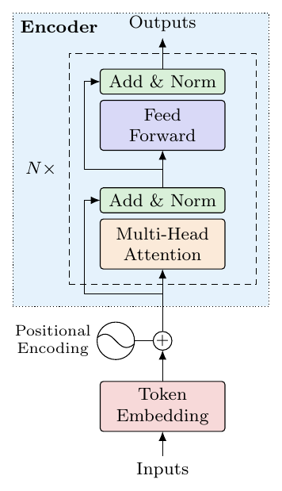
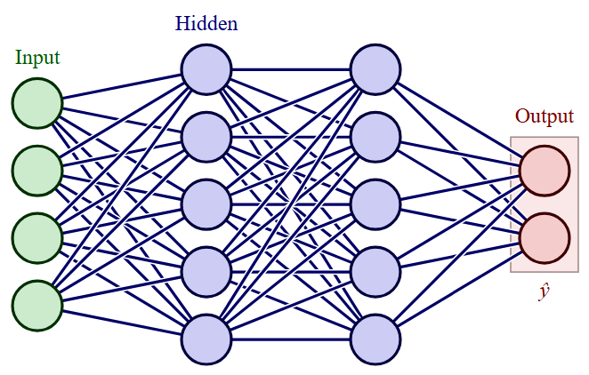
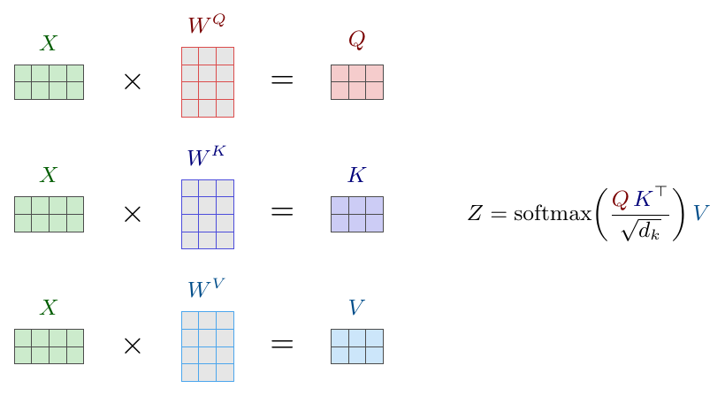
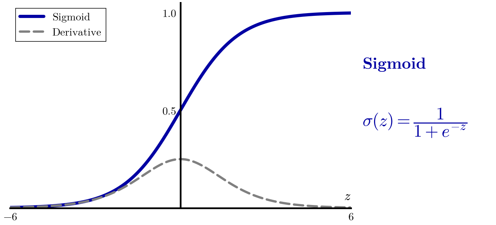

# ml-figures

This is an agent skill for drawing machine-learning figures in one
consistent, textbook-quality style. It renders the same visual language
through three backends:

- **SVG**: self-contained files that need no toolchain.
- **TikZ**: LaTeX-native vector output.
- **matplotlib**: plots drawn from data.

| block diagram | neuron graph | tensors | plots |
|---|---|---|---|
|  |  |  |  |

## Layout

```
SKILL.md                 entry point for the agent: workflow and backend choice
tokens.yaml              the whole look: palette, tints, strokes, fonts, concept -> colour
references/style-guide.md  rules tokens can't express: shapes, line meanings, layout
backends/svg/            mlsvg.py helper, mlfig.css, templates
backends/tikz/           mlfig.sty, templates
backends/mpl/            mlfig.py helper, mlfig.mplstyle, templates
scripts/gen_styles.py    tokens.yaml -> every backend's style file
scripts/render.py        render any figure to PNG/PDF and lint it
```

## Requirements

| backend | needs |
|---|---|
| SVG | Python 3.9+. To rasterise you need one of: `pip install cairosvg`, rsvg-convert, Inkscape, or Chrome/Edge |
| TikZ | a TeX distribution (TeX Live / MiKTeX) |
| matplotlib | `matplotlib`, `numpy` |
| regenerating styles | `pyyaml` |

## Re-theming

Edit `tokens.yaml`, then run `python scripts/gen_styles.py`. Running
`python scripts/gen_styles.py --check` exits non-zero if any generated file
is out of date, which is useful in CI.

## Credits

The visual style is modelled on the TikZ illustrations of the
[Deep Learning book](https://github.com/federicobrancasi/Deep-Learning) by
Federico Brancasi and Jacopo Manenti. The palette and conventions were
measured from those figures. All code and templates here were written from
scratch.

## License

Licensed under the GNU Affero General Public License v3.0. See
[LICENSE](LICENSE).
